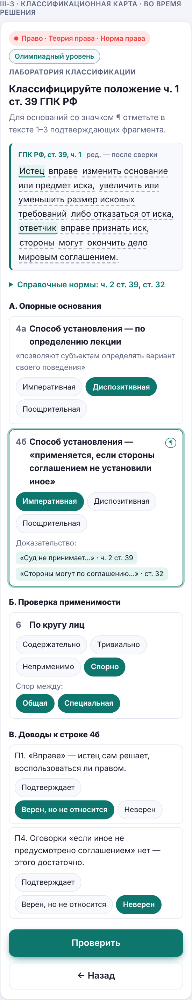
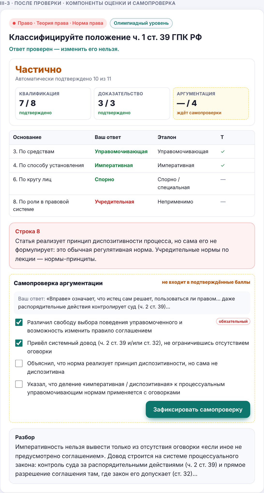
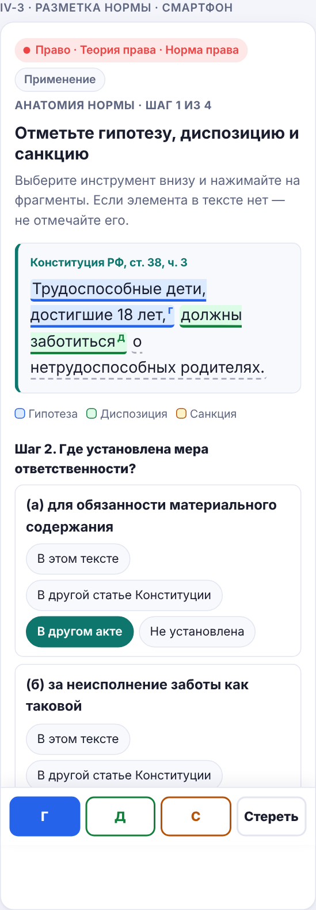
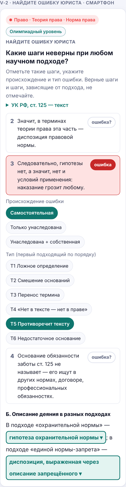
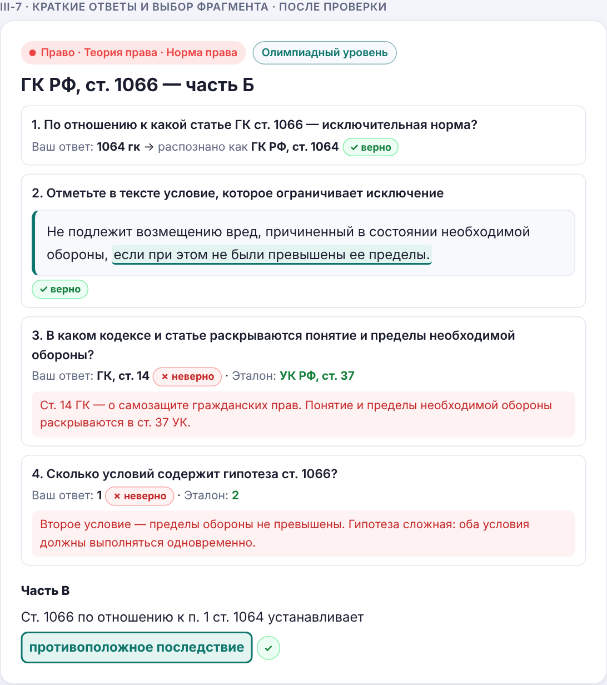
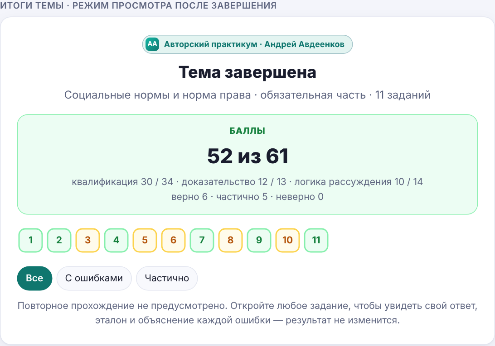
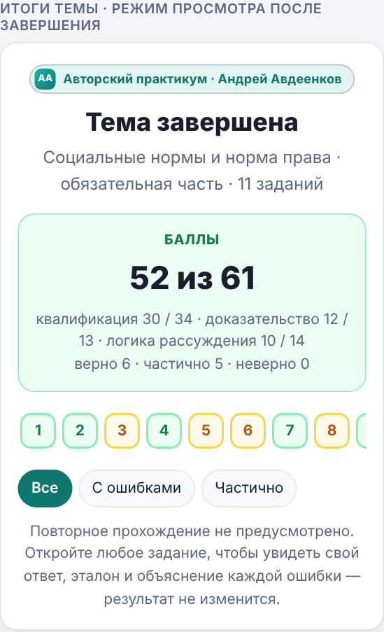

# Практикум «Норма права»: образцы заданий (версия 4 — автоматическая проверка)

Шесть заданий по спецификации [`pr-law-nrm-spec.md`](pr-law-nrm-spec.md). Для каждого:

- текст для ученика;
- **что проверяет программа** — каждый элемент, ключ, баллы;
- **какие ошибки объясняются ученику** — объяснение для конкретного неверного выбора;
- итог по баллам и время.

Самопроверки, развёрнутых ответов и ручной проверки нет. Все образцы проверяют **распознавание и самостоятельный анализ в закрытом пространстве ответов**; самостоятельное построение аргумента отложено (спецификация, § 1.1).

Изменения версии 4.1:
- новая типология ошибок (М2): содержательный тип и происхождение оцениваются раздельно;
- переработаны доводы, конструкторы и утверждения — по результатам аудита отвлекающих вариантов и независимости элементов ([`pr-law-nrm-quality-audit.md`](pr-law-nrm-quality-audit.md));
- убраны объяснения, которые подсказывали решение следующих заданий.

**Статус текстов норм:** уровень B. До сверки с официальным текстом в окончательный банк не входят. `[…]` — фрагмент, который будет уточнён при сверке.

| № | Задание | Часть | Форматы | Ур. | Баллы К / Т / Р | Мин |
|---|---|---|---|---|---|---|
| 1 | I-1. Шахматный турнир | обязательная | Ф1 | 1 | 10 / — / 5 | 7 |
| 2 | II-2. Общеобязательность и адресат | обязательная | Ф5 + Ф8 | 2 | — / — / 10 | 5 |
| 3 | III-3. ГПК, ст. 39 ч. 1 | обязательная | Ф1 + Ф7 | 3 | 9 / 3 / 6 | 10 |
| 4 | III-7. ГК, ст. 1066 | блок Б | Ф1 (отбор) + Ф3 + Ф8 | 3 | 10 / 2 / 3 | 10 |
| 5 | IV-3. Конституция, ст. 38 ч. 3 → СК, ст. 87, 115 | обязательная | Ф2 + Ф4 + Ф7 | 2 | 8 / 3 / 6 | 10 |
| 6 | V-2. Ошибка юриста: ст. 125 УК | обязательная | Ф5 + Ф2 + Ф8 | 3 | 4 / 4 / 11 | 10 |

**Обозначения в ключах:**
- ✓ — верно, полный балл;
- ½ — допустимый, но более слабый ответ: 0,5 балла, не зависит от рассуждения;
- = — равноправная альтернатива, полный балл;
- **Ошибка → объяснение** — что видит ученик при конкретном неверном выборе.

---

## Образец 1. I-1 — «Шахматный турнир»

**Обязательная часть · уровень 1 · навык Н1 · 7 мин · 15 баллов (К 10, Р 5)**

### Текст для ученика

> На открытом шахматном турнире произошло пять эпизодов.
>
> 1. Регламент турнира, утверждённый шахматной федерацией, обязывает участников пожимать руку сопернику перед партией. Участнику, отказавшемуся это сделать, засчитали поражение.
> 2. Участник попросил перенести партию с субботы, потому что вероучение, которое он исповедует, запрещает ему играть в этот день.
> 3. Зрители не аплодируют во время партии. Письменного правила нет, но так «принято всегда», и нарушителя встречают недовольными взглядами.
> 4. Игрок сообщил арбитру, что соперник по ошибке записал результат в его, игрока, пользу, хотя мог промолчать: «Иначе было бы нечестно».
> 5. Организатор опубликовал положение о турнире с объявленным призом, но приз не выплатил. Победитель взыскал его через суд.
>
> **Часть А.** Для каждого эпизода определите **вид социальной нормы** и **решающий признак** (один или два), по которому вы её отличили.
> Вид: правовая · моральная · религиозная · корпоративная · обычай · традиция · этикет · эстетическая.
> Признак: (а) кем установлена · (б) как возникла · (в) чем обеспечивается · (г) какие ценности выражает · (д) на кого распространяется.
>
> **Часть Б.** Рукопожатие — обычно норма этикета. Что изменилось в эпизоде 1? Для каждой характеристики правила отметьте «изменилась» или «не изменилась»: содержание правила · ценность, которую выражает правило · форма выражения · источник · способ обеспечения.

### Что проверяет программа

| Элемент | Ключ | Баллы | Ошибка → объяснение |
|---|---|---|---|
| Эп. 1, вид | **корпоративная** | К 1 | **этикет** → «Содержание правила этикетное, но оно записано в регламенте организации и обеспечено её санкцией — поражением». **правовая** → «Регламент федерации — не акт государства; поражение — санкция организации, а не государственное принуждение» |
| Эп. 2, вид | **религиозная** | К 1 | **моральная** → «Источник требования — вероучение, а не представления о добре и зле, общие для всех». **обычай / традиция** → «Правило не сложилось из повторения — его предписывает религия» |
| Эп. 3, вид | **обычай** ✓; этикет ½ | К 1 | **этикет** (½) → «Тишина — форма уважения, но решающее здесь другое: правило сложилось из длительного повторения и вошло в привычку». **традиция** → «По лекции традиция — стремление сохранить унаследованные формы поведения; здесь просто привычка». **корпоративная** → «Письменного правила организации нет» |
| Эп. 4, вид | **моральная** | К 1 | **этикет** → «Речь не о внешней форме обращения, а о честности — категориях “честно / нечестно”». **корпоративная** → «Игрок руководствуется собственной оценкой честности, а не правилом организации» |
| Эп. 5, вид | **правовая** | К 1 | **корпоративная** → «Положение о турнире — акт организатора, но взыскание через суд опирается на нормы ГК, обеспеченные государственным принуждением» |
| Эп. 1–5, признак | засчитывается, если выбран хотя бы один ключевой признак и ни одного противоречащего. Эп. 1: ключ (а), (в), противоречит (б). Эп. 2: ключ (а), (г). Эп. 3: ключ (б), противоречит (а). Эп. 4: ключ (г), (в), противоречит (а). Эп. 5: ключ (в), (а) =, противоречит (б) | К 5 | Например, эп. 3 + (а) → «У обычая нет автора: он складывается из повторения» |
| Б: содержание | **не изменилось** | Р 1 | «Требование то же — пожать руку» |
| Б: ценность | **не изменилась** | Р 1 | «Правило по-прежнему выражает уважение к сопернику; изменился не смысл, а то, кто и как его обеспечивает» |
| Б: форма | **изменилась** — записано в регламенте | Р 1 | «Этикет обычно не записан; здесь правило закреплено в документе» |
| Б: источник | **изменился** — организация | Р 1 | «Правило приняла федерация» |
| Б: обеспечение | **изменилось** — санкция организации | Р 1 | «Вместо неодобрения окружающих — поражение» |

**Почему признак (а) в эпизоде 5 — равноправный ответ.** Вид нормы «правовая» проверяется отдельно. Если ученик выбрал «правовая», признак «кем установлена» верен независимо от рассуждения: правовая норма установлена государством. Связка «правовая + (а)» не требует проверки обоснования.

---

## Образец 2. II-2 — «Общеобязательность и адресат»

**Обязательная часть · уровень 2 · навыки Н2, Н8 · 5 мин · 10 баллов (Р 10)**

### Текст для ученика

> Студент рассуждает так:
>
> **(1)** Норма, определяющая порядок оглашения судебного решения, адресована только судьям.
> **(2)** Общеобязательность — это обязательность правила для всех без исключения лиц.
> **(3)** Следовательно, эта норма не обладает признаком общеобязательности.
> **(4)** Значит, её правовой характер сомнителен — это скорее служебная инструкция.
>
> **Часть А.** Отметьте ошибочные шаги. Для каждого отмеченного шага укажите:
> - **происхождение ошибки:** самостоятельная ошибка · только унаследована от шага с исходной ошибкой (укажите его номер) · унаследована и содержит собственную ошибку;
> - **содержательный тип** — для самостоятельной ошибки и для собственной ошибки унаследованного шага (типология — спецификация, § 3.4).
>
> **Часть Б.** Соберите корректное утверждение:
> «Общеобязательность означает, что норма обязательна для **[1]** независимо от их воли и согласия. В шаге 2 общеобязательность подменена **[2]**. Широта круга адресатов характеризует норму по другому основанию — **[3]**».
> [1]: всех, кому она адресована · всех без исключения · тех, кто согласился её соблюдать · только государственных органов
> [2]: требованием, чтобы правило касалось каждого члена общества · требованием государственного принуждения · требованием письменной формы · требованием официального опубликования
> [3]: по кругу лиц · по сфере действия · по средствам регулирования · по выполняемым функциям

### Что проверяет программа

| Элемент | Ключ | Баллы | Ошибка → объяснение |
|---|---|---|---|
| Первый ошибочный шаг | **(2)** | Р 2 | **отмечен (1)** → «Посылка верна: норма действительно адресована судьям». **отмечен только (4)** → «Вывод (4) сломан раньше — в шаге 2» |
| Остальные шаги | отмечены (3) и (4), не отмечен (1) | Р 1 | — |
| Шаг 2: происхождение | **самостоятельная** | Р 1 | — |
| Шаг 2: тип | **Т1 — ложное определение понятия** | Р 1 | **Т2** → «По порядку правил первым подходит Т1: шаг даёт определение понятия, и оно неверно» |
| Шаг 3: происхождение | **только унаследована от шага 2** | Р 1 | **самостоятельная** → «Если принять определение из шага 2, вывод (3) логичен: собственной ошибки в нём нет» |
| Шаг 4: происхождение | **только унаследована от шага 2** | Р 1 | **от шага 3** → «Укажите шаг с исходной ошибкой — это шаг 2» |
| Слот [1] | **всех, кому она адресована** | Р 1 | **всех без исключения** → «Это и есть ошибка шага 2». **согласился** → «Обязательность правовой нормы не зависит от согласия» |
| Слот [2] | **требованием, чтобы правило касалось каждого члена общества** | Р 1 | **государственного принуждения** → «Это другой признак нормы права; шаг 2 о нём не говорит» |
| Слот [3] | **по кругу лиц** | Р 1 | **по сфере действия** → «По лекции это деление на федеральные, региональные, локальные нормы» |

**Независимость элементов.** [1] — определение, [2] — какое свойство подменено, [3] — название основания. Правильный ответ в одном слоте не выводится из другого. Варианты [2] не содержат слова «круг» — подсказки для [3] нет.

---

## Образец 3. III-3 — ГПК РФ, ст. 39 ч. 1

**Обязательная часть · уровень 3 · навыки Н3, Н4, Н5, Н9 · 10 мин · 18 баллов (К 9, Т 3, Р 6)**

### Текст для ученика

> **Положение.** ГПК РФ, ст. 39, ч. 1: «Истец вправе изменить основание или предмет иска, увеличить или уменьшить размер исковых требований либо отказаться от иска, ответчик вправе признать иск, стороны могут окончить дело мировым соглашением.» *[редакция — после сверки]*
>
> **Справочные нормы:**
> - ГПК, ст. 39, ч. 2: «Суд не принимает отказ истца от иска, признание иска ответчиком и не утверждает мировое соглашение сторон, если это противоречит закону или нарушает права и законные интересы других лиц.»
> - ГПК, ст. 32: «Стороны могут по соглашению между собой изменить территориальную подсудность для данного дела до принятия его судом к своему производству. […]»
>
> **Часть А. Опорные основания.** Для оснований со значком ¶ отметьте 1–3 подтверждающих фрагмента.
> 1. По предмету регулирования ¶
> 2. По характеру регулируемых отношений
> 3. По средствам регулирования ¶
> 4. По способу установления правил поведения — **дважды, по двум определениям**:
>    4а. по определению лекции: диспозитивные нормы «позволяют субъектам правоотношений определять вариант своего поведения»;
>    4б. по определению: диспозитивная норма применяется, **если стороны своим соглашением не установили иное** ¶
> 5. По выполняемым функциям
>
> **Часть Б. Проверка применимости:** содержательно (укажите вид) · тривиально · неприменимо · спорно (укажите, между какими видами).
> 6. По кругу лиц · 7. По времени действия · 8. По роли в правовой системе
>
> **Часть В. Доводы.** Для каждого утверждения решите:
> - **верно и само по себе обосновывает ответ в строке 4б**;
> - **верно, но ответ в строке 4б само по себе не обосновывает**;
> - **неверно**.
>
> П1. Слово «вправе» означает, что истец сам решает, воспользоваться ли правом.
> П2. Суд проверяет отказ от иска и мировое соглашение на соответствие закону и правам других лиц (ч. 2 ст. 39).
> П3. Там, где ГПК допускает изменение процессуального правила соглашением сторон, он говорит об этом прямо (ст. 32).
> П4. В ч. 1 ст. 39 нет оговорки «если иное не предусмотрено соглашением сторон».
> П5. Принцип диспозитивности гражданского процесса означает, что стороны могут соглашением изменять процессуальные правила.
> П6. Суд обязан принять отказ истца от иска, если истец заявил его добровольно.

### Что проверяет программа

| Элемент | Ключ | Баллы | Ошибка → объяснение |
|---|---|---|---|
| 1. Предмет | **гражданско-процессуальная**; Т: «истец», «иска», «ответчик», «мировым соглашением» | К 1 · Т 1 | **гражданско-правовая** → «Норма регулирует действия сторон в суде, а не сами спорные гражданские права» |
| 2. Характер | **процессуальная** | К 1 | **материальная** → то же |
| 3. Средства | **управомочивающая**; Т: «вправе», «могут» | К 1 · Т 1 | **обязывающая** → «Норма не предписывает изменить иск или отказаться от него, а предоставляет такую возможность» |
| 4а. Метод (лекция) | **диспозитивная** | К 1 | **императивная** → «По определению лекции императивная норма оставляет единственный вариант поведения. Здесь истец выбирает, как поступить» |
| 4б. Метод (узкое определение) | **императивная**; Т: только фрагменты ч. 2 ст. 39 или ст. 32 | К 1 · Т 1 | **диспозитивная** → «Вы применили определение лекции. По этому определению вопрос другой: могут ли стороны соглашением отменить эти права? Не могут: распорядительные действия контролирует суд (ч. 2 ст. 39); когда ГПК допускает соглашение сторон, он говорит об этом прямо (ст. 32)». **Т: отмечено только «вправе»** → «“Вправе” доказывает управомочивающий характер (строка 3), а не метод» |
| 5. Функции | **регулятивная** | К 1 | **охранительная** → «Норма закрепляет права участников процесса, а не меры на случай нарушения» |
| 6. Круг лиц | **спорно: общая / специальная** ✓; спорно с одним видом ½; содержательно: специальная ½ | К 1 | **неприменимо / тривиально** → «Основание применимо, но спорно: истец и ответчик — процессуальные роли, а не особый статус лица, как у иностранца в ст. 276 УК; стать стороной может любой» |
| 7. Время | **тривиально** | К 1 | **содержательно: постоянная** → «Ответ формально верен, но ничего не различает: так можно сказать почти о любой норме кодекса» |
| 8. Роль | **неприменимо** ✓; тривиально = | К 1 | **учредительная** → «Статья реализует принцип диспозитивности, но сама его не формулирует: это обычная регулятивная норма» |
| П1 | **верно, но не обосновывает** | Р 1 | «Утверждение верно, но относится к строке 3: свобода выбора поведения не означает, что правило можно изменить соглашением» |
| П2 | **верно и обосновывает** | Р 1 | — |
| П3 | **верно и обосновывает** | Р 1 | — |
| П4 | **верно, но не обосновывает** | Р 1 | **обосновывает** → «Оговорки действительно нет, но этого недостаточно: у многих диспозитивных норм её тоже нет, а диспозитивность может следовать из системы закона». **неверно** → «Утверждение о тексте верно: такой оговорки в ч. 1 нет» |
| П5 | **неверно** | Р 1 | «Принцип диспозитивности — свобода сторон распоряжаться предметом спора и средствами защиты, а не право менять процессуальные правила» |
| П6 | **неверно** | Р 1 | «Противоречит ч. 2 ст. 39: суд не принимает отказ, если он противоречит закону или нарушает права других лиц» |

**Как снят спор С1.** Вместо одной строки с ответом «зависит от определения» — две строки с однозначными ключами. Ученик, который умеет применить оба определения, получает оба балла.

**Против угадывания по шаблону «раз спрашивают дважды — ответы разные».** В III-2 (ст. 210 ГК, предыдущее задание) оба определения дают **одинаковый** ответ — «диспозитивная». В банке не менее трети пар «по двум определениям» совпадают.

**Против угадывания по «абсолютным словам».** В доводах нет слов «все», «всегда», «достаточно», выдающих неверный вариант. Неверные утверждения П5 и П6 сформулированы без таких слов.

---

## Образец 4. III-7 — ГК РФ, ст. 1066

**Блок Б · уровень 3 · навыки Н3, Н4, Н5, Н7 · 10 мин · 15 баллов (К 10, Т 2, Р 3)**

### Текст для ученика

> **Положение.** ГК РФ, ст. 1066: «Не подлежит возмещению вред, причиненный в состоянии необходимой обороны, если при этом не были превышены ее пределы.»
> **Справочно.** ГК РФ, ст. 1064, п. 1, абз. 1: «Вред, причиненный личности или имуществу гражданина, а также вред, причиненный имуществу юридического лица, подлежит возмещению в полном объеме лицом, причинившим вред.»
>
> **Часть А.** Из 11 оснований выберите **4–6**, которые содержательно характеризуют ст. 1066, и квалифицируйте по ним. Для основания «по объёму регулирования» отметьте фрагменты обеих статей.
>
> **Часть Б.**
> 1. По отношению к какой статье ГК ст. 1066 — исключительная норма? *(введите номер)*
> 2. Отметьте в тексте ст. 1066 условие, которое ограничивает исключение.
> 3. В каком кодексе и какой статье раскрываются понятие необходимой обороны и её пределы? *(введите)*
> 4. Сколько условий содержит гипотеза ст. 1066? *(число)*
>
> **Часть В.** Соберите утверждение:
> «Ст. 1066 — исключительная, а не специальная норма, потому что по отношению к п. 1 ст. 1064 она **[1]**. Исключительность ст. 1066 **[2]**. Квалификация “специальная по кругу лиц” здесь ошибочна, потому что **[3]**».
> [1]: устанавливает для части случаев противоположное последствие · уточняет для части случаев размер возмещения · применяется только к гражданам, но не к организациям · действует, только если договором не предусмотрено иное
> [2]: относительна — существует лишь по отношению к конкретной общей норме · следует из самого текста ст. 1066 без сопоставления с другими нормами · означает, что ст. 1066 имеет большую юридическую силу, чем ст. 1064
> [3]: «обороняющийся» — не особый статус лица, а ситуация, в которой может оказаться любой · деление по кругу лиц к нормам ГК неприменимо · специальными по кругу лиц бывают только нормы уголовного закона

### Что проверяет программа

| Элемент | Ключ | Баллы | Ошибка → объяснение |
|---|---|---|---|
| Отбор: ключевые | **по предмету, по характеру отношений, по объёму регулирования (Р1)** | К 3 (по 1) | не выбран Р1 → «Главное в ст. 1066 — изъятие из общего правила ст. 1064» |
| Отбор: неприменимые | **по кругу лиц, по роли в правовой системе, по времени действия, рекомендательная (Р2)** не выбраны | К 1 | **по кругу лиц: специальная** → «“Обороняющийся” — не особый статус, а ситуация; это смешение основания № 7 и Р1». **по роли: дефинитивная** → «Определения обороны в статье нет — оно в УК» |
| Отбор: допустимые и дискуссионные | по сфере действия; по способу установления; по средствам; по функциям | — | проверяются и комментируются, в баллы не входят. «По функциям» дискуссионно: показывается в разборе |
| Квалификация: предмет / характер / объём | **гражданско-правовая / материальная / исключительная** | К 3 | **специальная** (Р1) → «Специальная норма сохраняет последствие общей, исключительная устанавливает противоположное» |
| Т: объём | фрагменты «Не подлежит возмещению» **и** «подлежит возмещению в полном объеме» | Т 1 | отмечена одна статья → «Исключительность относительна: нужно показать и общее правило» |
| Б1 | **1064** (нормализация: «ст. 1064», «1064 ГК», «п. 1 ст. 1064 ГК РФ») | К 1 | **1066** → «Это сама исключительная норма» |
| Б2 | фрагмент **«если при этом не были превышены ее пределы»** | Т 1 | — |
| Б3 | **УК, ст. 37** (нормализация кодекса и номера) | К 1 | **другая статья** → «Понятие и пределы необходимой обороны раскрываются в ст. 37 УК; ГК их не определяет» |
| Б4 | **2** | К 1 | **1** → «Второе условие — пределы обороны не превышены. Гипотеза сложная: оба условия одновременно» |
| [1] | **устанавливает… противоположное последствие** | Р 1 | **уточняет размер возмещения** → «Так устроена специальная норма: она сохраняет последствие общей и конкретизирует его». **только к гражданам** → «Это смешение с основанием “по кругу лиц”». **если договором не предусмотрено иное** → «Это признак диспозитивности, другое основание» |
| [2] | **относительна…** | Р 1 | **большую юридическую силу** → «Обе статьи — в одном кодексе. Исключительность — соотношение содержания, а не юридической силы» |
| [3] | **«обороняющийся» — ситуация…** | Р 1 | **неприменимо к ГК** → «Деление применимо к нормам любой отрасли». **только УК** → «Специальные нормы по кругу лиц есть в разных отраслях» |

**Независимость элементов.** У каждого слота свой список вариантов. Прежняя версия с общим списком для двух слотов позволяла решать методом исключения, а формулировка третьего слота повторяла ответ второго — это исправлено. Каждый отвлекающий вариант соответствует реальной ошибке (специальная норма, круг лиц, диспозитивность, юридическая сила) и имеет своё объяснение.

---

## Образец 5. IV-3 — Конституция РФ, ст. 38 ч. 3 → СК РФ, ст. 87, 115

**Обязательная часть · уровень 2 · навыки Н6, Н7, Н9 · 10 мин · 17 баллов (К 8, Т 3, Р 6)**

### Текст для ученика

> **Положение.** Конституция РФ, ст. 38, ч. 3: «Трудоспособные дети, достигшие 18 лет, должны заботиться о нетрудоспособных родителях.»
>
> **Шаг 1.** Отметьте гипотезу, диспозицию и санкцию. Если элемента в тексте нет — не отмечайте.
>
> **Шаг 2.** В этом шаге под санкцией понимается **мера юридической ответственности**. Где она установлена:
> (а) за неисполнение обязанности **материального содержания** родителей;
> (б) за неисполнение обязанности **заботы как таковой** — внимания, общения, — когда жизни и здоровью родителей ничто не угрожает?
> Варианты: в этом тексте · в другой статье Конституции · в другом акте · не установлена.
> Вид гипотезы по лекции: простая · сложная · альтернативная.
>
> **Шаг 3.** Определите роль каждого фрагмента Семейного кодекса.
> А — ст. 87, п. 1: «Трудоспособные совершеннолетние дети обязаны содержать своих нетрудоспособных нуждающихся в помощи родителей и заботиться о них.»
> Б — из того же пункта: «нуждающихся в помощи».
> В — ст. 87, п. 2: «При отсутствии соглашения об уплате алиментов алименты на нетрудоспособных нуждающихся в помощи родителей взыскиваются с трудоспособных совершеннолетних детей в судебном порядке.»
> Г — ст. 115 «Ответственность за несвоевременную уплату алиментов», п. 2: «При образовании задолженности по вине лица, обязанного уплачивать алименты по решению суда,»
> Д — продолжение: «виновное лицо уплачивает получателю алиментов неустойку в размере одной десятой процента от суммы невыплаченных алиментов за каждый день просрочки.» *[ред. Федерального закона от 29.07.2018 № 224-ФЗ; проверить изменения 2026 г.]*
>
> Роли (повторяются; не все нужны): 1 — регулятивное предписание, устанавливающее обязанность · 2 — дополнительное условие, сужающее гипотезу по сравнению с Конституцией · 3 — порядок реализации обязанности · 4 — гипотеза охранительной нормы · 5 — санкция — мера ответственности · 6 — правовосстановительная мера: принудительное исполнение самой обязанности · 7 — к этой обязанности не относится.
>
> **Шаг 4.** Верно или неверно?
> У1. По п. 2 ст. 87 алименты можно взыскать и на трудоспособного родителя, если он нуждается в помощи.
> У2. П. 2 ст. 87 связывает судебное взыскание с отсутствием соглашения об уплате алиментов.
> У3. Если санкция — мера ответственности (узкий смысл), судебное взыскание по п. 2 ст. 87 санкцией не является.
> У4. Если санкция понимается широко, как в лекции, санкцией можно считать принудительное исполнение решения суда при уклонении плательщика.
> У5. Неустойка по п. 2 ст. 115 взыскивается при задолженности по алиментам независимо от вины плательщика.
> У6. Любая мера юридической ответственности является санкцией, но не любая санкция является наказанием.

### Что проверяет программа

| Элемент | Ключ | Баллы | Ошибка → объяснение |
|---|---|---|---|
| Шаг 1: гипотеза | «Трудоспособные дети, достигшие 18 лет,» — **Г** (Д =, спорная граница С10); «о нетрудоспособных родителях» — Г = Д | Т 1 | — |
| Шаг 1: диспозиция | «должны заботиться» — **Д** | Т 1 | **С** → «“Должны” выражает обязанность, а не меру на случай её неисполнения» |
| Шаг 1: санкция | **не размечена** | Т 1 | размечена → «В тексте ч. 3 ст. 38 санкции нет. Не дописывайте элемент, которого в тексте нет: ищите его в других актах (шаг 2)» |
| Шаг 2 (а) | **в другом акте** (СК, ст. 115) | К 1 | **не установлена** → «Неустойка за виновную просрочку алиментов — мера ответственности (ст. 115 СК)» |
| Шаг 2 (б) | **не установлена** | К 1 | **в другом акте** → «Мер ответственности за неисполнение обязанности заботы как таковой, когда жизни и здоровью родителей ничто не угрожает, закон не устанавливает» |
| Вид гипотезы | **сложная** | К 1 | **альтернативная** → «Условия должны быть одновременно: трудоспособность, возраст, нетрудоспособность родителей» |
| А | **1** | К 1 | — |
| Б | **2** | К 1 | **7** → «Конституция требует только нетрудоспособности родителей, СК добавляет нуждаемость: гипотеза уже» |
| В | **3** ✓; **6** ½ | К 1 | **6** (½) → «Частично: решение суда затем исполняется принудительно. Но п. 2 описывает другое: суд взыскивает алименты “при отсутствии соглашения”, без нарушения». **5** → «Неустойки и иного дополнительного обременения здесь нет» |
| Г | **4** | К 1 | — |
| Д | **5** | К 1 | **6** → «Неустойка не исполняет саму обязанность, а добавляет обременение сверх долга. Статья прямо называется “Ответственность…”» |
| У1 | **неверно** | Р 1 | «П. 2 говорит о нетрудоспособных нуждающихся в помощи родителях: нужны оба условия» |
| У2 | **верно** | Р 1 | — |
| У3 | **верно** | Р 1 | — |
| У4 | **верно** | Р 1 | — |
| У5 | **неверно** | Р 1 | «П. 2 ст. 115 говорит о задолженности, образовавшейся “по вине” обязанного лица» |
| У6 | **верно** | Р 1 | **неверно** → «Мера ответственности — санкция в любом из двух смыслов; а правовосстановительные меры и неустойка — санкции, но не наказания» |

**Независимость и сигналы.** В прежней версии У1 и У2 были взаимоисключающими (одно следовало из другого) — У1 заменено проверкой условия «нетрудоспособных». Абсолютные слова теперь есть и в верном (У6), и в неверном (У5) утверждении.

**Как снят спор С4.** В шагах 2–3 смысл санкции задан в условии. В шаге 4 утверждения сформулированы отдельно для узкого и широкого смысла, и каждое однозначно верно или неверно.

---

## Образец 6. V-2 — «Ошибка юриста»: ст. 125 УК РФ

**Обязательная часть · уровень 3 · навыки Н6, Н8, Н9 · 10 мин · 19 баллов (К 4, Т 4, Р 11)**

### Текст для ученика

> **Положение.** УК РФ, ст. 125: «Заведомое оставление без помощи лица, находящегося в опасном для жизни или здоровья состоянии и лишенного возможности принять меры к самосохранению по малолетству, старости, болезни или вследствие своей беспомощности, в случаях, если виновный имел возможность оказать помощь этому лицу и был обязан иметь о нем заботу либо сам поставил его в опасное для жизни или здоровья состояние, — наказывается […]» *[санкция — после сверки]*
>
> **Рассуждение студента:**
> **(1)** В уголовном праве часть статьи до слова «наказывается» называют диспозицией статьи.
> **(2)** Значит, в терминах теории права эта часть — диспозиция правовой нормы.
> **(3)** Следовательно, гипотезы у этой нормы нет, а значит, нет и условий её применения: наказание грозит любому, кто оставил беспомощного без помощи.
> **(4)** Слова «был обязан иметь о нем заботу» не указывают, откуда возникает обязанность; её основание нужно искать в других нормах (например, семейного законодательства), в договоре или профессиональных обязанностях.
> **(5)** Правило «не оставляй без помощи беспомощного, о котором ты обязан заботиться» в статье прямо не сформулировано, поэтому такого правила поведения в российском праве нет.
>
> **Часть А.** Отметьте шаги, **неверные при любом научном подходе** к структуре нормы. Для каждого отмеченного шага укажите происхождение и содержательный тип ошибки (как в II-2). «Унаследована» можно указать только от шага, который вы сами отметили как бесспорно ошибочный.
>
> **Часть Б.** Какой шаг оценивается по-разному в разных подходах? *(номер или «нет»)*
> Соберите утверждение: «Описание деяния в ст. 125 в подходе “охранительной нормы” — это **[1]**, а в подходе “единой нормы-запрета” — **[2]**».
> [1]: гипотеза охранительной нормы · диспозиция · санкция · регулятивная норма
> [2]: диспозиция, выраженная через описание запрещённого · гипотеза · санкция · условие, восстанавливаемое из Общей части
>
> **Часть В. Работайте в подходе «охранительной нормы».** Разметьте текст ст. 125: Г: деяние · Г: потерпевший · Г: виновный · С.
> Где находится:
> - правило «не оставлять без помощи» — выражено в статье прямо · подразумевается (выводится из охранительной нормы) · установлено в другом акте;
> - условия о возрасте и вменяемости — в этой статье · в другой статье того же кодекса · в другом акте.
>
> Вид гипотезы в целом и вид условия «был обязан… либо сам поставил…»: простое · сложное · альтернативное.

### Что проверяет программа

| Элемент | Ключ | Баллы | Ошибка → объяснение |
|---|---|---|---|
| Шаг (3) отмечен | **да** | Р 2 | не отмечен → «Условия прямо записаны в статье (“в случаях, если виновный имел возможность…”) и в Общей части УК. Спорно, как их называть, а не существуют ли они» |
| Шаг (5) отмечен | **да** | Р 1 | — |
| Не отмечены (1), (2), (4) | **да** | Р 1 | **(2)** → «В подходе “единой нормы-запрета” шаг верен; он не ошибочен при любом подходе — см. часть Б». **(4)** → «Шаг верен: основание обязанности заботы ст. 125 не называет». **(1)** → «Так термин употребляется в уголовном праве» |
| Шаг (3): происхождение | **самостоятельная** | Р 1 | **унаследована от шага 2** → «Шаг 2 не ошибочен при любом подходе, поэтому унаследовать от него бесспорную ошибку нельзя. Ошибка шага 3 — собственная: она опровергается текстом статьи» |
| Шаг (3): тип | **Т5 — противоречие тексту нормы** | Р 1 | **Т4** → «Шаг 3 не выводит “нет нормы” из отсутствия слов — он отрицает условия, которые в тексте есть» |
| Шаг (5): происхождение | **самостоятельная** | Р 1 | — |
| Шаг (5): тип | **Т4 — «нет в тексте статьи — нет в праве»** | Р 1 | — |
| Б: зависящий от подхода шаг | **2** | Р 1 | — |
| Б: слот [1] | **гипотеза охранительной нормы** | Р 1 | **диспозиция** → «Это ответ для подхода “единой нормы-запрета”» |
| Б: слот [2] | **диспозиция, выраженная через описание запрещённого** | Р 1 | **условие из Общей части** → «Из Общей части восстанавливается гипотеза (возраст, вменяемость), а не само описание деяния» |
| В: разметка «деяние» | «Заведомое оставление без помощи» | Т 1 | — |
| В: разметка «потерпевший» | «лица, находящегося в опасном… состоянии и лишенного возможности…» + «по малолетству, старости, болезни или вследствие своей беспомощности» | Т 1 | — |
| В: разметка «виновный» | «если виновный имел возможность…» + «и был обязан иметь о нем заботу» + «либо сам поставил…» | Т 1 | — |
| В: разметка «С» | «наказывается […]» | Т 1 | «наказывается» как Г-деяние → «Это мера на случай совершения деяния — санкция» |
| Правило «не оставлять без помощи» | **подразумевается** | К 1 | **в другом акте** → «В других актах установлено основание — обязанность заботы. Правило не оставлять без помощи в опасности в подходе “охранительной нормы” выводится из самой охранительной нормы» |
| Возраст и вменяемость | **в другой статье того же кодекса** (Общая часть УК) | К 1 | — |
| Гипотеза в целом | **сложная** | К 1 | **альтернативная** → «Условия о деянии, потерпевшем и виновном нужны одновременно» |
| «был обязан… либо сам поставил…» | **альтернативное** | К 1 | **сложное** → «Союз “либо”: достаточно одного из условий» |

**Как снят спор С3.** Автоматически оцениваются только шаги, ошибочные при любом подходе. Для шага, зависящего от подхода, ученик называет роль описания деяния **в каждом подходе отдельно**. Слоты [1] и [2] логически независимы: знание одного подхода не даёт ответа для другого. Прежняя пара «верен / неверен» была взаимоисключающей и решалась по одной половине — заменена. Разметка выполняется в подходе, **заданном в условии**.

**Вне оценки** (уйдёт в экспертную часть, спецификация § 7): свободная реконструкция «если — то — иначе» и сравнение подходов своими словами.

---

## Макеты экранов

Прототип [`mockups/nrm-samples.html`](mockups/nrm-samples.html) — на стилях платформы. Блоков самопроверки нет. На ширине 390 px горизонтальной прокрутки страницы нет.

| Экран | Снимок |
|---|---|
| III-3 во время решения (смартфон): строки 4а и 4б по двум определениям, «спорно» с выбором спорящих видов, оценка доводов |  |
| III-3 после проверки (компьютер): баллы по компонентам К / Т / Р, статусы строк, объяснение конкретной ошибки |  |
| IV-3 (смартфон): разметка с закреплённой палитрой, карта элементов |  |
| V-2 (смартфон): шаги, происхождение и тип ошибки (Т1–Т6), роль описания деяния в каждом подходе |  |
| III-7 после проверки: нормализованная ссылка на статью, выбор фрагмента вместо ввода, типичная ошибка |  |
| Итоги и просмотр (компьютер и смартфон): одна сумма, разбивка по компонентам, без повторного прохождения |   |
